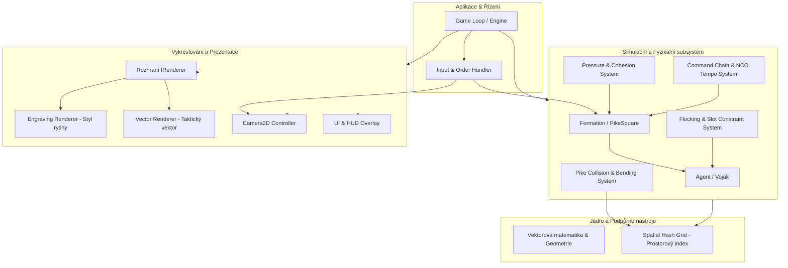
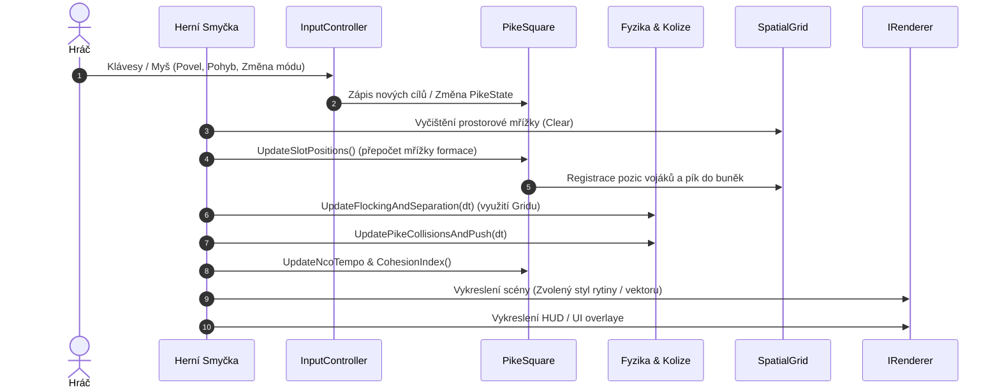

# Architektura projektu PikeSim (PikeSquareSimulator)

Tento dokument definuje systémovou architekturu, datové toky, fyzikální modely a plán modularizace projektu **PikeSim** – simulátoru renesančních formací a mechaniky *Push of Pikes* v reálném čase.

---

## 1. Architektonické cíle a požadavky (Drivers)

1. **Vysoký výpočetní výkon v reálném čase (60 FPS):**
   * Simulace stovek až tisíců agentů (pikenýři, mušketýři, důstojníci).
   * Schopnost provádět prostorové dotazy a detekci kolizí bez propadu snímkové frekvence.
2. **Oddělení fyziky/simulace od vykreslování (Decoupled Architecture):**
   * Čistý simulační model nezávislý na použitém rendereru.
   * Možnost plynule přepínat renderovací styly (*Rytina* vs. *Vektorové taktické zobrazení*), případně v budoucnu přidat headless režim pro benchmarky a trénování AI.
3. **Data-Oriented & Modular Design:**
   * Ukládání agentů a těles v souvislých blocích paměti (`std::vector`), minimalizace alokací za běhu simulační smyčky.
   * Modulární rozpad stávajícího monolitického souboru `main.cpp`.
4. **Rozšiřitelnost:**
   * Snadné přidávání nových typů zbraní (píka, halaparta, meč, arkebuza/mušketa), dalších formací, terénních překážek a řetězce velení.

---

## 2. Přehled architektury (High-Level Diagram)

Následující diagram znázorňuje vztahy mezi jednotlivými subsystémy aplikace:



---

## 3. Rozpad subsystémů a modulů

### 3.1. Jádro (`core/`)
* **`Types.h`**: Společné enumy a datové typy (`Role`, `PikeState`, `VisualMode`, identifikační typy `AgentId`, `FormationId`).
* **`MathUtils.h`**:
  * Normalizace úhlů do intervalu $[-\pi, \pi]$.
  * Matematika úseček: průsečíky úsečka-úsečka (`LineSegmentIntersection`), vzdálenost bodu od úsečky, promítání vektorů.
* **`SpatialHashGrid.h` / `.cpp`**:
  * Prostorové mřížkové indexování (2D Spatial Hash).
  * Redukuje složitost vyhledávání sousedů a kolizí z $O(N^2)$ na $O(N)$.
  * Každý agent a každá úsečka píky se registruje do příslušných buněk mřížky.

### 3.2. Simulace a Fyzika (`simulation/`)
* **`Agent.h` / `.cpp`**:
  * Stav jednotlivce: pozice, rychlost, orientace těla, orientace zbraně, hmotnost, kolizní rádius, zbraň, morálka, stamina.
* **`Pike.h` / `.cpp`**:
  * Geometrie píky: kořen (uchycení v rukou), hrot, efektivní délka, aktuální ohyb/napětí, stav (Porte, Charge, Grounded).
* **`FlockingSystem.h` / `.cpp`**:
  * Výpočet sil působících na agenta:
    1. *Spring force* (přitahování do `targetSlot` ve formaci).
    2. *Separation force* (vzájemné odpuzování těl vojáků).
    3. *Obstacle avoidance* (vyhýbání se padlým tělům či překážkám).
  * Numerická integrace (Semi-implicit Euler nebo Verlet) s omezovačem maximální rychlosti a tlumením třením.
* **`PikePhysicsSystem.h` / `.cpp`**:
  * Detekce kolizí mezi úsečkami pík nepřátelských i spřátelených řad.
  * Výpočet odklonění hrotů při kontaktu pík.
  * Zaseknutí / propletení pík (*entanglement*) a generování brzdného odporu.
* **`PressureSystem.h` / `.cpp`**:
  * Mechanika *Push of Pikes*:
    * Pokud přední řada narazí na odpor a zadní řady pochodují kupředu, vzniká kompresní tlak.
    * Tlak se přenáší z řady na řadu a kumuluje se v čele formace.
    * Vyhodnocení přetlačení: čtverec s vyšším hybným momentem a hloubkou řad vytlačuje slabší čtverec vzad.

### 3.3. Formace a Velení (`formation/`)
* **`Formation.h` (Abstraktní bázová třída / Praporec)**:
  * Správa seznamu vojáků a rot, společný pivot, rotace, rychlost pochodu.
  * Dynamické řazení zástupů rot, podpora pro vyčlenění rot (Detach) a opětovné sloučení (Merge).
* **`Rota.h` (Zástup – nejmenší ovladatelná jednotka)**:
  * Specializovaná rota 10 pikenýrů nebo 6 mušketýrů tvořící jeden zástup (file) od čela do hloubky.
  * Zbraňová homogenita, správa přidělených agentů.
* **`PikeSquare.h` / `.cpp`**:
  * Konkrétní implementace čtvercové/obdélníkové formace (počet řad a sloupců, rozestupy).
  * Výpočet geometrických slotů (`UpdateTargetSlots`).
  * Manévry:
    * *Kolo (Wheel):* Rotace kolem levého/pravého předního rohu.
    * *Obrat na místě (90° Turn):* Maticová záměna slotů a orientace vojáků.
    * *Pochod k waypointu:* Dvoufázový přesun (natočení čela + synchronní postup).
* **`CommandChain.h` / `.cpp`**:
  * Logika důstojníků (`NCO`, `Leader`).
  * Výpočet zpoždění povelů na základě vzdálenosti od velitele.
  * Vliv vnějších NCO na tempo formace (`GetNcoTempoFactor`).

### 3.4. Vykreslování a Prezentace (`rendering/`)
* **`IRenderer.h`**:
  * Rozhraní definující metody `BeginFrame()`, `DrawFormation()`, `DrawAgent()`, `DrawPike()`, `DrawUI()`, `EndFrame()`.
* **`EngravingRenderer.h` / `.cpp`**:
  * Historický styl papírové rytiny: tlumené barvy, kreslení stínů, klobouků s péry, čepelí a hrotů.
* **`VectorRenderer.h` / `.cpp`**:
  * Taktický režim: zobrazení vektorů rychlostí, silových polí, indexu tlaku a mřížek formace.
* **`CameraController.h` / `.cpp`**:
  * Ovládání kamery Raylibu (`Camera2D`): plynulý posun (WASD/šipky/drag myší), zoom kolečkem, sledování středu vybrané formace.

### 3.5. Uživatelské rozhraní a Vstupní subsystém (`ui/`, `input/`)
* **`InputController.h` / `.cpp`**:
  * Výběr jednotek (kliknutí LMB, výběrový obdélník LMB Drag).
  * Taktické zadávání povelů ve stylu *Total War*: kliknutí RMB pro pochod na pozici, tažení RMB Drag pro určení směru natočení čela s vykreslením siluety ("ducha") formace.
* **`UIManager.h` / `.cpp`**:
  * **Spodní lišta formací (HUD Formation Bar):** Obdélníkové miniatury ovládaných praporců s ukazateli morálky, staminy a počtu živých vojáků.
  * **Karta formace (Formation Card):** Detailní inspektor otevřený dvojklikem na formaci či miniaturu. Zahrnuje statistiky morálky, rozpis zbraní, vizuální editor zástupů s drag-and-drop prohazováním rot, rychlé šablony tvaru a vyčlenění rot (Detach/Merge).

---

## 4. Datové struktury a paměťový model

Pro zajištění vysokého výkonu se architektura vyhýbá hlubokým dědickým stromům a zbytečným dynamickým alokacím během herního ticku.

### 4.1. Struktura Agenta
```cpp
struct Agent {
    int id;
    Role role;
    Vector2 position;
    Vector2 velocity;
    Vector2 targetSlot;
    float angle;
    float pikeAngle;
    float swingTimer;
    float mass;
    float maxForce;
    float stamina;
    float pressureReceived; // Kumulovaný tlak ze zadních řad
    bool isAlive;
};
```

### 4.2. Spatial Hash Grid
Mřížka pokrývající herní svět velikostí buněk odpovídající zhruba maximální délce píky ($\approx 100\,\text{px}$):
```cpp
class SpatialHashGrid {
public:
    SpatialHashGrid(float cellSize, int worldWidth, int worldHeight);
    void Clear();
    void InsertAgent(int agentId, Vector2 pos);
    void InsertPikeSegment(int agentId, Vector2 start, Vector2 end);
    void QueryAgentsInRadius(Vector2 pos, float radius, std::vector<int>& outIds);
    void QueryNearbyPikes(Vector2 start, Vector2 end, std::vector<int>& outPikeIds);
};
```

---

## 5. Herní smyčka (Update Lifecycle)

Každý simulační snímek probíhá v přesně definovaném pořadí:



---

## 6. Návrh cílové adresářové struktury

Monolitický `main.cpp` bude rozdělen do následující přehledné adresářové struktury:

```text
PikeSim/
├── CMakeLists.txt                # Konfigurace CMake a Raylib FetchContent
├── run.bat                       # CLI spouštěcí skript (využívá MinGW z CLionu)
├── README.md                     # Základní popis projektu
├── AGENTS.md                     # Instrukce pro vývojové asistenty a přispěvatele
├── docs/
│   ├── architecture.md           # Tento dokument systémové architektury
│   └── game_design.md            # Kompletní herní design dokument (GDD)
├── include/
│   ├── core/
│   │   ├── Types.h               # Enumy, role, konstanty
│   │   ├── MathUtils.h           # Geometrické výpočty, průniky úseček
│   │   └── SpatialHashGrid.h     # Prostorové indexování pro kolize O(N)
│   ├── simulation/
│   │   ├── Agent.h               # Entita vojáka
│   │   ├── FlockingSystem.h      # Pružiny slotů a odpuzování
│   │   ├── PikePhysics.h         # Kolize a proplétání pík
│   │   └── PressureSystem.h      # Přenos tlaku ("Push") a soudržnost
│   ├── formation/
│   │   ├── Formation.h           # Bázová třída formace
│   │   ├── PikeSquare.h          # Pikenýrský blok, geometrie, manévry
│   │   └── CommandChain.h        # Vliv NCOs a velitelů
│   ├── rendering/
│   │   ├── IRenderer.h           # Rozhraní pro renderery
│   │   ├── EngravingRenderer.h   # Vykreslování stylu dobové rytiny
│   │   ├── VectorRenderer.h      # Vektorový laboratorní renderer
│   │   └── CameraController.h    # 2D kamera a ovládání pohledu
│   └── ui/
│       └── UIManager.h           # HUD panely, tlačítka a vizualizace dat
└── src/
    ├── main.cpp                  # Inicializace okna, hlavní smyčka
    ├── core/
    │   ├── MathUtils.cpp
    │   └── SpatialHashGrid.cpp
    ├── simulation/
    │   ├── FlockingSystem.cpp
    │   ├── PikePhysics.cpp
    │   └── PressureSystem.cpp
    ├── formation/
    │   ├── Formation.cpp
    │   ├── PikeSquare.cpp
    │   └── CommandChain.cpp
    ├── rendering/
    │   ├── EngravingRenderer.cpp
    │   ├── VectorRenderer.cpp
    │   └── CameraController.cpp
    └── ui/
        └── UIManager.cpp
```

---

## 7. Fáze a Implementační Roadmapa

* **Fáze 1: Současný stav (Milestone 1 - Dokončeno)**
  * Základní čtverec 10×10 + 4 NCOs + velitel.
  * Pohyb, manévr kola, obrat o 90° na místě, waypointy.
  * Zpomalování formace při zaostávání NCOs.
  * Dva renderovací režimy v jednom souboru.
* **Fáze 2: Refaktoring do modulární architektury**
  * Rozpad `main.cpp` na moduly v `include/` a `src/`.
  * Úprava `CMakeLists.txt` pro sestavení modulů.
  * Ověření funkčnosti identického chování přes `run.bat`.
* **Fáze 3: Prostorové indexování a druhý čtverec (1v1 Sandbox)**
  * Implementace `SpatialHashGrid`.
  * Zavedení nepřátelského čtverce (červení vs. modří).
  * Jednoduchá AI oponenta (pochod vstříc hráči).
* **Fáze 4: Fyzika pík a střet („Push of Pikes“)**
  * Detekce kolizí hrotů a těles pík (úsečka vs úsečka).
  * Propletení pík a brzdná síla.
  * Generování a přenos tlaku napříč formací, prolomení linie.
* **Fáze 5: Rozšířené zbraně a terén**
  * Halapartníci uvnitř formace (čištění koridorů).
  * Mušketýrské rukávce na rozích a kouřová clona z výstřelů.
