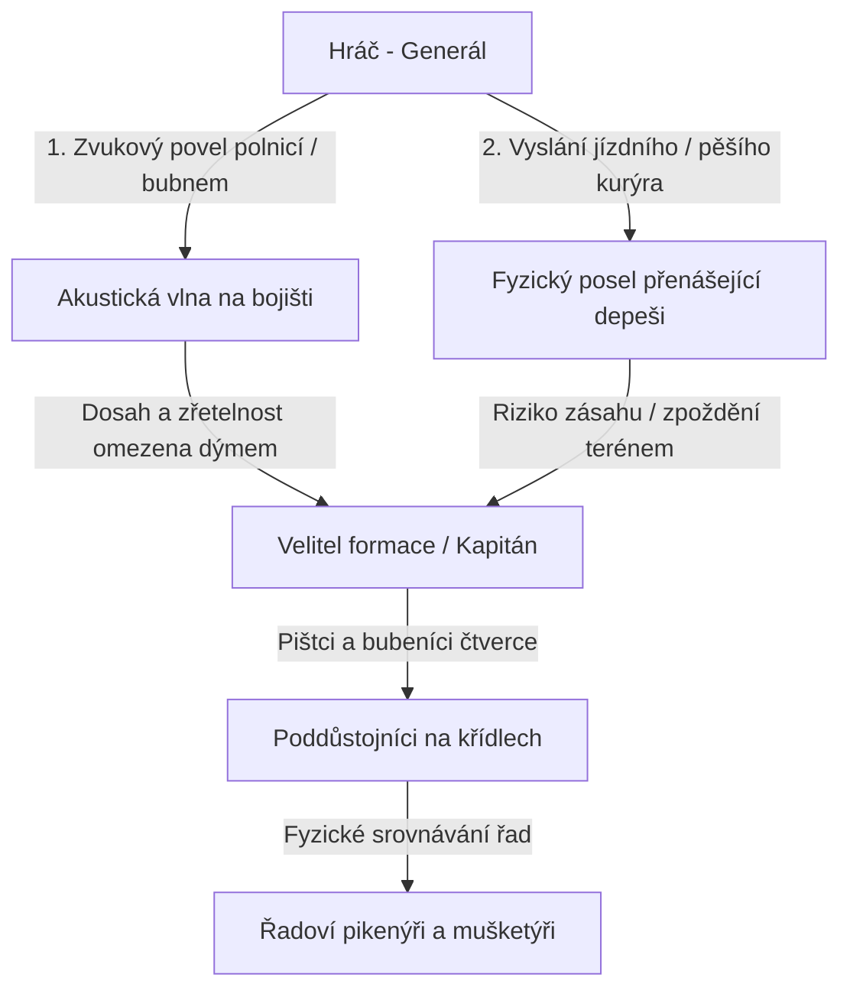
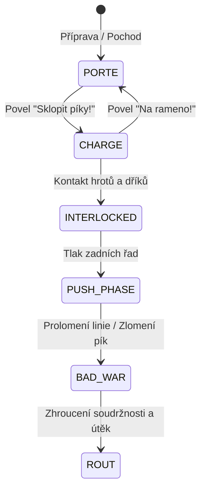
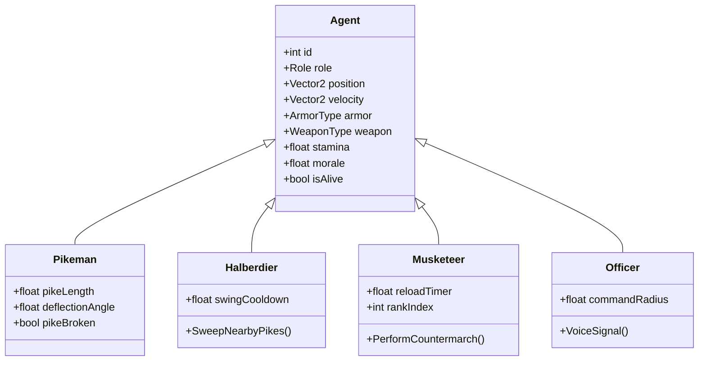
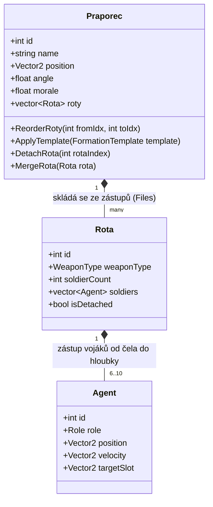
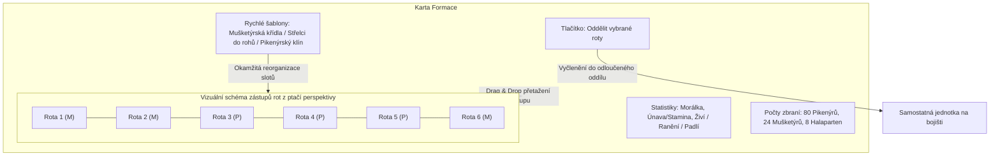
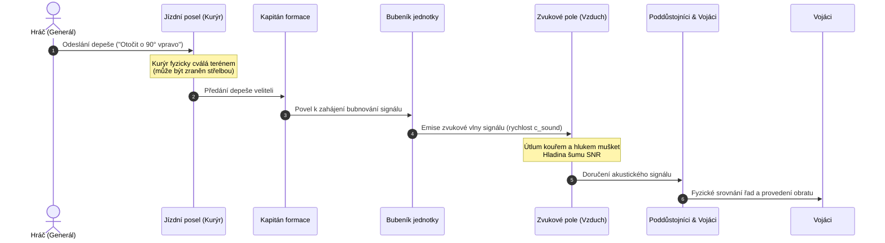
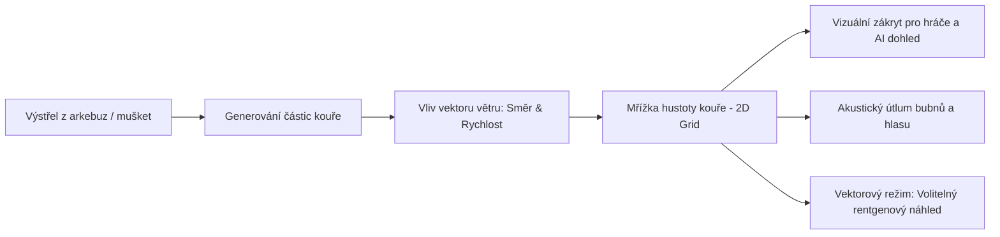

# Game Design Document: PikeSim (PikeSquareSimulator)

Komplexní herní a simulační design dokument definující herní mechaniky, fyzikální chování, akustické velení, zbraně a vizuální styl projektu **PikeSim**.

---

## 1. Vize a Designové Pilíře

**PikeSim** je taktický fyzikální simulátor renesančního pěchotního střetu (*Pike and Shot era*, 16.–17. století). Cílem projektu je autenticky zrekonstruovat brutální mechaniku **„Push of Pikes“** (srážky pikenýrských čtverců), koordinaci mušketýrských rukávců a chaos velení na kouřem zahaleném bojišti.

### Klíčové pilíře (Core Pillars)
1. **Fyzikální emergentnost místo abstraktních čísel:**
   * Vojáci nejsou bloky se statickými životy (HP), ale fyzikální agenti s hmotností, setrvačností, zorným polem a silovým kontaktem se sousedy.
   * Chování formace (držení linie, vlnění, prohnutí, roztržení) přirozeně vyvěrá ze vzájemného působení stovek jednotlivců.
2. **Autentická zbraňová mikro-fyzika:**
   * Píka je 4–5 metrů dlouhá pružná tyč s vlastním momentem setrvačnosti, odporem proti ohybu a rizikem zlomení pod extrémním tlakem.
3. **Akustika, poslové a tření války (Clausewitzian Friction):**
   * Generál neovládá bojiště okamžitým kliknutím myši. Rozkazy se šíří jako akustické vlny bubnů a prostřednictvím zranitelných fyzických kurýrů.
4. **Dvojí vizuální identita:**
   * Hráč může kdykoliv přepínat mezi imerzivním stylem **oživlé dobové mědirytiny** a analytickým **taktickým vektorovým režimem** s vizualizací silových polí.

---

## 2. Role Hráče a Herní Režimy

Hráč v PikeSim vystupuje v roli **vrchního velitele (generála)** stojícího v zázemí, který pomocí signálů a poslů řídí jednotlivé bojové formace (španělské tercie, švýcarské čtverce, nizozemské prapory).

### Herní režimy

#### A. Taktický Sandbox (Laboratoř)
* Volná tvorba scénářů v reálném čase i v pauze.
* Možnost konfigurovat:
  * Počty a geometrii čtverců (např. 16×16 hluboký švýcarský klín vs. 32×8 široká nizozemská linie).
  * Poměr sil (*Pike to Shot ratio* – podíl střelců ku pikenýrům).
  * Fyzikální parametry: tuhost pružin pík, koeficient tření půdy, sílu a směr větru, morálku mužstva.
* Nástroje pro inspekci: sledování distribuce tlaku ($F$), grafy ztrát, heatmapy hustoty formací.

#### B. Taktické Výzvy a Historické Scénáře
Knihovna předpřipravených úkolů s pevnými podmínkami vítězství a hodnocením efektivity:
1. *Obrana soutěsky:* Udržet zúžený průsmyk s 200 pikenýry proti přesile za pomoci správného načasování povelu *Receive Cavalry* a salv arkebuz.
2. *Švýcarský klín:* Prorazit zformovanou linii nepřítele masivním kinetickým náporem hluboké kolony dříve, než mušketýři na křídlech rozstřílejí zadní řady.
3. *Vymanévrování v dýmu:* Provedení úhybného kola (*Wheel*) a protiútoku v husté kouřové cloně bez ztráty soudržnosti křídel.

---

## 3. Mikro-fyzika Pík a Fáze „Push of Pikes“

Jádrem simulačního enginu je střet lesa pík. Každá píka je modelována jako **orientovaná úsečka** ukotvená v rukou vojáka s torzní pružinou udržující zbraň ve směru pohledu.

### 3.1. Fyzikální model píky
* **Délka:** 3.5–5.0 m (v simulaci škálováno na pixely vůči rozestupům vojáků).
* **Torzní tuhost ($k_\tau$):** Síla, která vrací vychýlenou píku zpět do klidové osy.
* **Maximální mez průhybu ($\theta_{\max}$):** Pokud úhel vychýlení překročí mez nebo příčná síla $F_\perp > F_{\text{break}}$, píka se zlomí a voják tasí poboční zbraň.
* **Brzdný odpor propletení:** Při křížení dvou nepřátelských pík vzniká kontaktní třecí bod, který omezuje dopředný pohyb obou vojáků.

### 3.2. Čtyři fáze střetu

| Fáze | Fyzikální děj v simulaci | Klíčové chování jednotek |
|---|---|---|
| **1. Přiblížení (Approach)** | Píky skloněny do vodorovné polohy (`CHARGE`). Rychlost pochodu klesá na 40 %. Mušketýři na rozích pálí poslední salvu. | Udržování rovného čela formace pomocí NCOs. |
| **2. Propletení (Interlocking)** | Hroty pík se střetnou s protějšími dříky. Engine počítá průniky úseček. Dříky se začínají ohýbat a vzájemně se odklánějí. | Hroty zasahují první vojáky; padlí v přední řadě padají pod nohy ostatním. |
| **3. Tlak (Push of Pikes)** | Přední řady stojí v zaklínění. Zadní řady (3. až 16. řada) pochodují kupředu a fyzicky tlačí tělo na tělo do mužů před sebou. Vzniká kumulativní kinetický tlak ($P_{\text{total}}$). | Čtverec s vyšší hmotností, hloubkou a staminou začíná fyzicky posouvat celou nepřátelskou formaci vzad. |
| **4. Bad War (Kolaps & Melee)** | Píky jsou propletené na doraz nebo polámané. Vojáci tasí katzbalgery, meče a dýky. Nastupují halapartníci ze středu formace k prosekání koridorů. | Kritický pokles soudržnosti (`Cohesion < 40 %`) vede k panice a rozpadu čtverce na chaotický hlouček. |

---

## 4. Jednotky, Role, Zbroj a Doplňování Řad

Každá formace je složena z několika typů specialistů s rozdílným vybavením a funkcí:

### 4.1. Role a Vybavení
1. **Přední pikenýři (Kozáci / Přední řady):**
   * *Zbroj:* Ocelový kyrys a helma (morion/cabasset).
   * *Odolnost:* Zásah hrotem do kyrysu je ze 75 % odražen bez zranění, absorbuje kinetický impuls.
2. **Zadní pikenýři (Lehké řady):**
   * *Zbroj:* Bez zbroje (pouze kolet/kabátec), zranitelní hroty i střelbou.
   * *Úloha:* Poskytují čistou tlačnou sílu (*Momentum*) a nahrazují padlé.
3. **Halapartníci a Doppelsöldneři (Uprostřed bloku):**
   * *Zbraň:* Halaparta nebo obouruční meč (*Zweihänder*).
   * *Schopnost:* Úder aplikuje boční sílu na propletené nepřátelské píky, vychyluje je nebo láme a otevírá koridor pro vlastní postup.
4. **Mušketýři a Arkebuzíři (Rukávce na rozích):**
   * *Mechanika kontramarše (Countermarch):* První řada vystřelí, otočí se a koridorem mezi zástupy odchází do zadní řady nabíjet. Tím je zajištěna nepřetržitá palba.
5. **Důstojníci (Kapitán, NCOs, Bubeníci):**
   * *Kapitán:* Určuje směr a globální chování čtverce.
   * *NCOs na rozích:* Korigují tempo otáčení (kolo) a zarovnání řad.
   * *Bubeníci & Pištci:* Akustické retranslátory rozkazů.

### 4.2. Mechanika padlých a doplňování řad
* **Těla jako fyzické překážky:** Padlý voják nemizí z mapy. Jeho tělo zůstává na zemi s kolizním rádiusem a zvyšuje lokální tření terénu. Živí vojáci přes něj musí překračovat, což narušuje geometrickou mřížku.
* **Gravitace slotů (Doplňování zástupů):** Pokud padne voják v $k$-té řadě, voják přímo za ním v $(k+1)$-té řadě přebírá jeho slot jako prioritní cíl. Mezera se tak posouvá směrem do zadních řad, zatímco bojové čelo zůstává celistvé.

### 4.3. Taktická hierarchie: Praporec a Rota (Zástup)
Bojové formace v PikeSim nejsou rigidní nedělitelné bloky, ale mají pevnou vnitřní strukturu založenou na historických zástupech:

1. **Rota (File / Zástup) – základní stavební kámen formace:**
   * **Definice:** Rota je nejmenší ovladatelná jednotka tvořená přesně jedním zástupem vojáků seřazených v jedné linii za sebou od bojového čela do hloubky formace.
   * **Zbraňová homogenita:** Každá rota je specializovaná na jeden konkrétní typ zbraně (čistě pikenýrská, čistě mušketýrská, čistě halapartnická). V rámci jedné roty se nemíchají zbraně různých kategorií.
   * **Hloubka roty (10 vs. 6 vojáků):**
     * **10 vojáků (Pikenýrská rota):** Tradiční hluboký šik nezbytný pro kumulaci kinetické tlačné síly při *Push of Pikes* a krytí předních řad lesem skloněných hrotů.
     * **6 vojáků (Mušketýrská rota):** Taktická hloubka optimalizovaná pro mechaniku plynulého kontramarše (jedna řada pálí na čele, zbylých pět zástupem za ní postupně nabíjí a rotuje).
     * **6 nebo 10 vojáků (Halapartnická rota):** Flexibilní hloubka podle toho, zda jsou halapartny integrovány do středu pikenýrského bloku (10) nebo operují na křídlech (6).
2. **Praporec (Formation / Ensign) – taktický svazek:**
   * Praporec vzniká seřazením jednotlivých rot (zástupů) těsně vedle sebe do kompaktního šiku.
   * Typický praporec kombinuje pikenýrské jádro (např. 10–16 pikenýrských rot o hloubce 10) a střelecká křídla či rohy (např. 4–8 mušketýrských rot o hloubce 6 na každém boku).

### 4.4. Oddělování a slučování rot (Detach & Merge)
Formace na bojišti jsou modulární a dynamické:
* **Oddělení rot (Detach):**
  * V kartě formace hráč označí konkrétní rotu či skupinu rot (např. 2 krajní mušketýrské roty) a zvolí povel *„Oddělit“* (nebo je z karty přetáhne myší na bojiště).
  * Tyto roty se okamžitě vyčlení z mateřského praporce jako samostatný **odloučený oddíl** (minipraporec) s vlastním velením, vlastním výběrovým kruhem a samostatnou miniaturou ve spodní liště.
  * Odloučený oddíl lze ovládat zcela nezávisle (např. vyslat střelce jako předsunutou clonu do lesa, bránit křídlo nebo obsadit vyvýšeninu).
* **Opětovné sloučení (Merge):**
  * Hráč vybere odloučenou jednotku a klikne pravým tlačítkem myši (RMB) na mateřský či jiný přátelský praporec s povelem *„Připojit se“*.
  * Vojáci přiběhnou k formaci a včlení se do ní jako nové zástupy na příslušné křídlo, přičemž praporec automaticky přepočítá své těžiště a cílové sloty.

---

## 5. Uživatelské Rozhraní, Ovládání Myší a Karta Formace (Total War styl)

Pro intuitivní velení využívá PikeSim moderní taktické rozhraní inspirované sérií *Total War*, plně přizpůsobené historickému fungování renesančních formací a zástupů.

### 5.1. Ovládání formací myší
Ovládání na bojišti probíhá v reálném čase pomocí myši:

* **Označení formace (LMB):**
  * Kliknutím levým tlačítkem myši na kteréhokoliv vojáka nebo praporečníka se vybere celý praporec (zobrazí se výběrový kruh a zvýrazní se čelo formace).
  * Tažením levého tlačítka (LMB Drag) lze označit více formací naráz pomocí výběrového obdélníku.
* **Pohyb na pozici (RMB Click):**
  * Jednoduché kliknutí pravým tlačítkem myši do terénu vydá rozkaz k pochodu na dané souřadnice. Formace si po příchodu zachová stávající úhel natočení nebo se srovná ve směru pochodu.
* **Nastavení pozice a orientace čela (RMB Drag – Total War styl):**
  * Stisknutí, tažení a uvolnění pravého tlačítka myši:
    * **Počáteční bod stisku:** Určuje cílovou pozici středu čela formace.
    * **Vektor tažení (Drag Vector):** Směr a úhel tažení myši definuje přesné natočení čela (heading).
    * **Silueta formace (Ghost Outline):** Během tažení se na zemi vykresluje poloprůhledná silueta budoucího rozestavení všech zástupů a skloněných pík, což umožňuje přesné naplánování linie před uvolněním tlačítka.
  * Po uvolnění tlačítka jednotka provede koordinovaný manévr (kolo/obrat na místě a pochod k novým slotům).

### 5.2. Spodní lišta formací (HUD Formation Bar)
Na spodním okraji obrazovky se nachází stálá lišta se všemi hráčem spravovanými jednotkami:
* **Miniatura praporce (Unit Card Banner):**
  * Každý praporec i odloučený oddíl má v liště obdélníkovou miniaturu.
  * Zobrazuje:
    * Ikonu převažující výzbroje (zkřížené píky, mušketa, halaparta).
    * Počet živých vojáků vůči maximálnímu stavu (např. `94/100`).
    * Barevný proužek morálky (zelená = pevná, žlutá = kolísající, červená = panika/útěk).
    * Taktický stav (pochod, běh, skloněné píky `CHARGE`, nabíjení/palba).
* **Rychlá interakce:**
  * Jedno kliknutí LMB na miniaturu označí formaci na bojišti.
  * Dvojklik (Double-click) na miniaturu vycentruje kameru na jednotku a otevře její detailní **Kartu formace**.

### 5.3. Karta formace (Formation Card & Editor zástupů)
Karta formace je centrálním inspektorem jednotky. Lze ji otevřít **dvojklikem na formaci přímo na bojišti** nebo **dvojklikem na její miniaturu v dolní liště**.

Karta obsahuje:
1. **Statistiky stavu mužstva:**
   * Počet živých, raněných a padlých vojáků.
   * Aktuální morálka a hladina staminy (únava snižuje rychlost pochodu a kinetický tlak v *Push of Pikes*).
   * Rozpis počtů vojáků podle jednotlivých zbraní.
2. **Vizuální schéma zástupů (Drag-and-Drop editor rot):**
   * Ptačí perspektiva na řazení jednotlivých zástupů (rot) v praporci.
   * **Prohazování zbraní:** Hráč může myší uchopit libovolný zástup a přetáhnout ho na jiné místo (např. přesunout střelecké zástupy z boků před pikenýry).
   * Po potvrzení změny se v herním světě přepočítají cílové sloty a vojáci plynule přeběhnou na nová místa.
3. **Rychlé taktické šablony tvaru formace:**
   * Tlačítka pro okamžité přeskupení:
     * *„Mušketýrská křídla“:* Pikenýři v pevném středu, mušketýři rovnoměrně na obou bocích.
     * *„Střelci v rozích“ (Tercio Bastions):* Mušketýři vysunuti na čtyři vnější rohy formace.
     * *„Pikenýrský beran“:* Střelci staženi vzad, pikenýři zformováni do úzkého a hlubokého čela pro proražení.
4. **Správa a dělení rot:**
   * V kartě lze vybrat konkrétní roty a stiskem tlačítka *„Oddělit“* je vyslat na bojiště jako samostatný odloučený oddíl.

### 5.4. Souhra ovládání myší s velením a zpožděním (Sandbox vs. Taktická bitva)
Ovládání myší je sladěno s modelem Clausewitzovského tření války podle zvoleného herního režimu:
* **V laboratorním Sandboxu:**
  * Příkazy zadané myší (RMB / RMB Drag) se provádějí **okamžitě bez zpoždění** – ideální pro laboratorní testování kolizí, průhybu pík a fyziky.
* **V Taktických výzvách a Bitvách (Autentické velení):**
  * Kliknutí RMB nevydá přímý fyzický impuls vojákům, ale vytvoří **rozkazový cíl (Command Objective)**.
  * Generál na cíl automaticky vyšle kurýra na koni nebo zatroubí polnice.
  * Jednotka zahájí pochod/manévr teprve v okamžiku, kdy jezdec dorazí ke kapitánovi formace a bubeníci čtverce předají signál křídlům. Hráč tak musí předvídat zpoždění a plánovat manévry s předstihem.

---

## 6. Akustické Velení, Zvukové Vlny a Poslové (Kurýři)

Bojiště 16. století je chaotické, hlučné a neprostupné. PikeSim toto simuluje mechanikou přenosu rozkazů:

### 6.1. Fyzika šíření zvuku (Akustické signály)
* **Rychlost šíření:** Zvukový signál se šíří rychlostí $c \approx 340\,\text{m/s}$ (v měřítku simulace přepočteno na pixely za sekundu).
* **Útlum a poměr signálu k šumu (SNR - Signal to Noise Ratio):**
  $$I(d) = \frac{I_0}{1 + \alpha_{\text{smoke}} \cdot d} \cdot \frac{1}{d}$$
  Kde:
  * $I_0$ je počáteční hlasitost bubnů (zesiluje se počtem živých bubeníků ve čtverci).
  * $\alpha_{\text{smoke}}$ je koeficient hustoty kouře v prostoru mezi bubeníkem a posluchačem.
  * Pokud je hladina okolního hluku (střelba, vřava boje tělo na tělo) vyšší než intenzita signálu $I(d)$, vzniká **šance na přeslechnutí povelu**.
* **Důsledek přeslechnutí:** Vzdálené křídlo pokračuje v předchozím pohybu, což vede k rozlomení formace na dvě nesouvislé skupiny.

### 6.2. Poslové (Kurýři)
* Pro dálkové rozkazy mezi odloučenými formacemi generál vysílá kurýry (jezdec na koni nebo lehký běžec).
* Kurýr je plnohodnotná herní entita, která:
  * Pohybuje se terénem po reálné trajektorii.
  * Může být zasažen zbloudilou kulí z muškety nebo zajat nepřátelskou jízdou.
  * Pokud kurýr padne dříve, než dorazí k cílové formaci, **rozkaz není nikdy doručen** a jednotka jedná podle své lokální autonomní AI (drží pozici nebo ustupuje).

---

## 7. Simulace Kouře (Fog of War) a Smyslového Vnímání

Černý střelný prach produkuje obrovské množství hustého bílo-šedého kouře. Intenzivní salva 50 mušket dokáže na několik minut zcela oslepit celou sekci bojiště.

### 7.1. Částicové pole kouře
* Simulace kouře probíhá na zjednodušené 2D mřížce hustoty (Eulerian Grid) nebo pomocí částicového systému.
* Každá částice má životnost, poloměr rozptylu a unáší ji **vektor větru** $\vec{W} = (W_x, W_y)$.
* Kouř postupně sedimentuje a ředí se v čase.

### 7.2. Herní dopady kouře
1. **Ztráta viditelnosti v režimu Rytiny:**
   * Hráč vidí pouze obrysy těl a hroty pík vystupující z husté bílé mlhy.
   * Nepřátelské formace se vynořují až na vzdálenost několika metrů, což klade důraz na včasné naslouchání bubnům soupeře.
2. **Omezení AI zacílení střelců:**
   * Mušketýři v dýmu střílejí naslepo do předpokládaného směru; rozptyl střelby prudce roste a hrozí zásah vlastních jednotek (*Friendly Fire*).
3. **Akustický filtr:**
   * Hustý kouř pohlcuje vysoké tóny (pištce) a tlumí dunění bubnů, čímž násobí zpoždění a chaos v řetězci velení.
4. **Vektorový laboratorní režim (X-Ray):**
   * V taktickém laboratorním zobrazení (`KEY_T`) může hráč kouř zprůhlednit a sledovat silové vektory pod kouřovou clonou.

---

## 8. Vizuální Jazyk: Rytina vs. Laboratorní Vektor

Hra nabízí okamžité přepínání vizuálního podání stiskem klávesy `T`. Oba režimy vycházejí ze stejného fyzikálního stavu simulace.

| Aspekt | Styl Dobové Rytiny (`ENGRAVING`) | Taktický Vektorový Režim (`VECTOR`) |
|---|---|---|
| **Pozadí** | Texturovaný zažloutlý papír / pergamen, jemná tisková mřížka. | Tmavé laboratorní pozadí (černomodré), technický rastr. |
| **Vojáci** | Kreslení inkoustem, stíny na papíře, šrafování, barevná peříčka na kloboucích (oranžová pro NCO, červená pro velitele). | Zjednodušené geometrické body s barevným kódováním rolí (modrá, žlutá, červená). |
| **Zbraně** | Dřevěná dříka s ocelovými trojúhelníkovými hroty, tasené čepele mečů, sekery halaparten. | Tenké vektorové úsečky. Barva indikuje aplikované napětí: zelená (volná), žlutá (kontakt), červená (kritický tlak/lámání). |
| **Silová pole** | Zcela skrytá – hráč vnímá tlak pouze z vlnění a mačkání těl vojáků. | Vektory rychlostí vojáků, pružinové vazby na cílové sloty, plošná mapa kompresního tlaku čtverce. |
| **Kouř a atmosféra** | Neprůhledné oblaky inkoustového dýmu, stylizované záblesky výstřelů. | Zobrazeno jako vrstevnice hustoty dýmu s možností zapnout rentgenový průhled. |

---

## 9. Sandbox Editor, Konfigurace a Scénáře

### 9.1. Konfigurace formace (Inspector Panel)
V režimu sandboxu má hráč možnost detailně upravit parametry každého čtverce:
* **Rozměry jádra:** Počet sloupců ($C \in [4, 50]$) a řad ($R \in [4, 50]$).
* **Rozestupy vojáků:** Sevřený šik (*Order* – $0.9\,\text{m}$), otevřený pochodový šik (*Open Order* – $1.8\,\text{m}$).
* **Poměr střelců (Pike to Shot Ratio):**
  * *1:0* – Čistý švýcarský pikenýrský blok.
  * *2:1* – Klasická španělská tercie 16. století s mohutnými rukávci.
  * *1:1* – Pozdní třicetiletá válka (švédský / nizozemský model).
* **Morálka a zkušenost:** Od rekrutů (snadno panikaří při prvních ztrátách) po veterány (drží linii i při propletení pík).

### 9.2. Umisťování terénu a překážek
* **Palisády a španělští jezdci (*Cheval de frise*):** Fyzické překážky znemožňující sklonění pík a zastavující postup.
* **Vodní příkopy a bláto:** Zvyšují tření, zpomalují pochod a dramaticky snižují účinnost kinetického nápory při *Push*.
* **Vyvýšeniny (Kopce):** Bonus k dosahu střelby a gravitační výhoda při tlačení formací z kopce dolů.

---

## 10. Matematické a Fyzikální Vzorce Simulace

Pro přesnou implementaci v C++ definujeme klíčové vzorce simulačního jádra:

### 10.1. Síla přitažlivosti do slotu (Pružina)
$$\vec{F}_{\text{spring}} = -k \cdot (\vec{p}_{\text{agent}} - \vec{p}_{\text{slot}}) - c \cdot \vec{v}_{\text{agent}}$$
Kde $k = 6.0\,\text{N/m}$ je tuhost formace a $c = 0.85$ je tlumicí koeficient.

### 10.2. Vzájemné odpuzování těl (Separation)
Pro dva agenty se vzdáleností $d = \|\vec{p}_i - \vec{p}_j\| < 2r_{\text{body}}$:
$$\vec{F}_{\text{repulse}} = \frac{2r_{\text{body}} - d}{2r_{\text{body}}} \cdot F_{\max} \cdot \frac{\vec{p}_i - \vec{p}_j}{d}$$

### 10.3. Kumulace kompresního tlaku v řadách
Tlak $P_i$ působící na vojáka v $i$-té řadě od čela:
$$P_i = P_{\text{front\_resistance}} + \sum_{k=i+1}^{\text{rows}} m_k \cdot \max(0, \vec{v}_k \cdot \vec{d}_{\text{forward}})$$
Pokud $P_1 > P_{\text{collapse\_threshold}}$, přední řada se prolomí a formace je zatlačena vzad.

### 10.4. Index soudržnosti (Cohesion Index)
$$C = \max\left(0.0, 1.0 - \frac{1}{N \cdot d_{\text{crit}}} \sum_{i=1}^{N} \|\vec{p}_i - \vec{p}_{\text{slot}, i}\|\right)$$
Kde $d_{\text{crit}} = 1.5 \times \text{spacing}$. Pokud $C < 0.5$, formace ztrácí schopnost provádět manévry (kolo, obrat) a rychlost reakce se snižuje na minimum.
